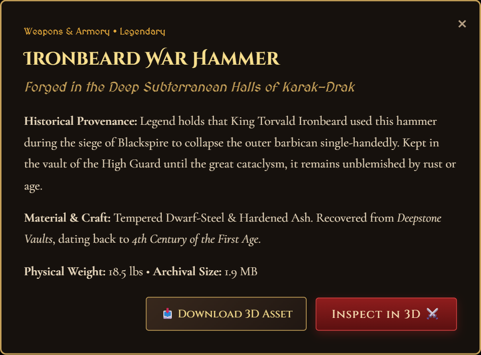

<div align="center">

# 🛡️ THE CHRONICLES OF ELDORIA
### *Grand Vintage 3D Reliquary & Curio Cabinet*

An immersive, dark-fantasy museum and game-style 3D showcase exhibiting **26 authentic medieval antiquities, armaments, and architectural relics**. Powered by Three.js WebGL, procedural Web Audio ambience, and native ES module import maps.

[](https://soorajstudio.github.io/Old-vintage-webiste/)
[](https://threejs.org/)
[](https://developer.mozilla.org/en-US/docs/Web/API/WebGL_API)
[-38bdf8?style=for-the-badge)](https://github.com/soorajstudio/Old-vintage-webiste)
[](#-license)

**[👉 Launch Live 3D Reliquary Demo](https://soorajstudio.github.io/Old-vintage-webiste/)**

---

</div>

## 📑 Table of Contents

- [🌟 Project Overview](#-project-overview)
- [📸 Visual Showcase & Previews](#-visual-showcase--previews)
  - [1. Game-Style Hero 3D Chamber](#1-game-style-hero-3d-chamber)
  - [2. Character Selection Deck (Square Previews)](#2-character-selection-deck-square-previews)
  - [3. The Alchemist & Armorer's Forge Studio](#3-the-alchemist--armorers-forge-studio)
  - [4. Complete Curio Cabinet Catalog](#4-complete-curio-cabinet-catalog)
  - [5. Curator's Codex & Lore Modal](#5-curators-codex--lore-modal)
- [✨ Core Features](#-core-features)
- [🏺 Archival Relic Roster (All 26 Models)](#-archival-relic-roster-all-26-models)
- [🎮 Interactive Controls & Keyboard Shortcuts](#-interactive-controls--keyboard-shortcuts)
- [📥 3D Model Download System](#-3d-model-download-system)
- [🚀 Quick Start & Installation](#-quick-start--installation)
  - [Option A: One-Click Windows Launcher](#option-a-one-click-windows-launcher)
  - [Option B: Node.js & Vite Dev Server](#option-b-nodejs--vite-dev-server)
  - [Option C: Zero-Build Static Web Server](#option-c-zero-build-static-web-server)
- [🌐 GitHub Pages Deployment Guide](#-github-pages-deployment-guide)
- [📁 Project Architecture](#-project-architecture)
- [🎧 Procedural Web Audio Soundscape](#-procedural-web-audio-soundscape)
- [📜 License](#-license)

---

## 🌟 Project Overview

**The Chronicles of Eldoria** transforms a collection of 26 diverse 3D models (`.glb`) into an interactive, dark-fantasy gaming experience. Styled after vintage royal reliquaries and classic RPG character/weapon selection screens (Dark Souls, Elden Ring, Skyrim), the application features:

- **Central 3D Viewport**: Full 360° inspection of high-fidelity 3D assets on a runic stone dias with drifting embers.
- **Game-Style Arrow Navigation**: Switch between relics using on-screen brass chevrons (`‹ PREV` / `NEXT ›`) or keyboard arrow keys (`←` / `→`).
- **Bottom Selection Deck**: Square preview cards with pre-rendered 3D thumbnail snapshots, rarity accents, and auto-centering scroll.
- **Curator's Codex Ledger**: Comprehensive lore, discovered era, physical weight, material provenance, and dynamic RPG combat/arcana stat meters.
- **One-Click 3D Model Downloads**: Every relic can be downloaded directly as a binary `.glb` asset.
- **Interactive Alchemist's Forge**: Live customization of surface patina, wireframe mode, Elemental Arcane Tints, and turntable spin velocity.

---

## 📸 Visual Showcase & Previews

### 1. Game-Style Hero 3D Chamber
> *The central 3D stage featuring the active artifact, left/right game navigation chevrons, relic counter badge, lighting controls, and the Curator's Codex with direct `.GLB` download.*

<div align="center">
  
</div>

---

### 2. Character Selection Deck (Square Previews)
> *The bottom carousel deck with 26 square cards featuring 3D thumbnail previews, active golden filigree highlight, rarity pips, and auto-centering scroll.*

<div align="center">
  
</div>

---

### 3. The Alchemist & Armorer's Forge Studio
> *Interactive metallurgical studio allowing visitors to tweak surface patina/roughness, inject elemental enchantments (Dragon Gold, Blood Ruby, Emerald Toxin, Astral Sapphire, Void Netherglow), and control turntable spin.*

<div align="center">
  
</div>

---

### 4. Complete Curio Cabinet Catalog
> *Filterable grid of all 26 antiquities with real-time search, category filters (Weapons, Arcana, Architecture, Curios), 3D thumbnails, and instant download buttons.*

<div align="center">
  
</div>

---

### 5. Curator's Codex & Lore Modal
> *Deep lore modal displaying historical provenance, discovery location, age, material breakdown, and quick 3D inspection.*

<div align="center">
  
</div>

---

## ✨ Core Features

| Feature | Description |
| :--- | :--- |
| **🎮 Game-Style Selection** | Select artifacts like selecting a champion or weapon in Dark Souls or Elden Ring. Smooth entrance scale animation on item swap. |
| **🔄 Auto-Framing Engine** | Calculates true 3D bounding box (`THREE.Box3`) to auto-center and calibrate camera framing for objects of any size (0.2m vial to 50m watchtower). |
| **🖼️ 26 Pre-Rendered Thumbnails** | Blazing fast page loads with pre-rendered square image previews—no need to wait for 800MB of 3D models to download just to view cards. |
| **📥 Direct .GLB Downloads** | Prominent vintage download buttons in the Codex ledger, catalog cards, and modal dialogs with original file size badges. |
| **💡 4 Cinematic Atmospheres** | Toggle between **Hearthfire & Torchlight** (amber flickering), **Moonlit Crypt** (silver/sapphire), **Arcane Resonator** (violet/teal), and **Sunlit Antiquarium** (daylight). |
| **📷 Daguerreotype Camera** | Renders and downloads high-resolution framed snapshots of any 3D relic with an antique museum plaque border. |
| **🔊 Procedural Soundscape** | Zero-download Web Audio synthesizer generating fireplace crackles, wood snaps, harmonic fifth drones, and tactile brass UI clicks. |
| **🌐 Native Import Map** | Zero-build deployment: runs natively in any modern browser on GitHub Pages with no bundler required. |

---

## 🏺 Archival Relic Roster (All 26 Models)

| # | Artifact Title | Category | Rarity | Discovered Origin | Weight | File Size | Format |
| :-: | :--- | :--- | :--- | :--- | :--- | :--- | :-: |
| **01** | **Ironbeard War Hammer** | ⚔️ Weapons | `Legendary` | Deepstone Vaults | 18.5 lbs | `1.9 MB` | `.GLB` |
| **02** | **Phial of Celestial Elixir** | 🧪 Arcana | `Mythic Relic` | Briarwood Hermitage | 0.8 lbs | `2.4 MB` | `.GLB` |
| **03** | **Aegis of the Sea King** | ⚔️ Weapons | `Rare Antiquity` | Fjord of Howling Wind | 12.0 lbs | `4.4 MB` | `.GLB` |
| **04** | **The Gilded Corsair Chest** | 🗝️ Curios | `Exotic Curio` | Sunken Galleon 'Santa Cruz' | 45.0 lbs | `4.8 MB` | `.GLB` |
| **05** | **Forester's Cleaving Hatchet** | ⚔️ Weapons | `Guild Artifact` | Nordic Frontier Woods | 4.2 lbs | `4.0 MB` | `.GLB` |
| **06** | **The Chrono-Data Matrix** | 🗝️ Curios | `Eldritch Mechanism`| The Clockwork Spire | 1.8 lbs | `2.0 MB` | `.GLB` |
| **07** | **Sunfire Relic Greatsword** | ⚔️ Weapons | `Mythic Relic` | Cathedral of Solitude | 7.5 lbs | `28.1 MB`| `.GLB` |
| **08** | **The Covenant Parchment Scroll** | 🧪 Arcana | `Ancient Relic` | Alexandrian Scriptorium | 1.2 lbs | `32.0 MB`| `.GLB` |
| **09** | **Monolith of the Eclipse** | 🗝️ Curios | `Forbidden Relic` | Shadowfell Caldera | 120 lbs | `32.1 MB`| `.GLB` |
| **10** | **Apothecary's Distillation Flask**| 🧪 Arcana | `Artisan Antiquity`| Old Guild Quarter | 2.1 lbs | `34.0 MB`| `.GLB` |
| **11** | **The Old Timber Apothecary** | 🏰 Architecture | `Architectural Wonder`| Cobblestone Lane | Scale Model | `35.0 MB`| `.GLB` |
| **12** | **Prismatic Resonator Crystal** | 🧪 Arcana | `Eldritch Marvel` | Astral Rift at Mt. Moriah | 14.2 lbs | `36.3 MB`| `.GLB` |
| **13** | **Reliquary Urn of High Kings** | 🗝️ Curios | `Royal Treasure` | Royal Mausoleum | 8.8 lbs | `37.1 MB`| `.GLB` |
| **14** | **Tribal Wyrm-Bone Pike** | ⚔️ Weapons | `Primal Artifact` | Frostfang Steppes | 6.4 lbs | `37.5 MB`| `.GLB` |
| **15** | **Deep-Delver's Mining Mattock** | ⚔️ Weapons | `Guild Artifact` | Mines of Mount Caelum | 9.2 lbs | `38.8 MB`| `.GLB` |
| **16** | **Sanctuary of the Moss-God** | 🏰 Architecture | `Sacred Monument` | The Whispering Glade | Scale Model | `39.0 MB`| `.GLB` |
| **17** | **Crossroads Signpost of Fate** | 🏰 Architecture | `Historical Relic` | Four Winds Intersection | Scale Model | `39.3 MB`| `.GLB` |
| **18** | **Berserker's Double Labrys** | ⚔️ Weapons | `Legendary` | Highland Chieftain Barrow | 16.0 lbs | `41.2 MB`| `.GLB` |
| **19** | **Trophy of the Dragon Slayer** | 🗝️ Curios | `Guild Masterpiece`| Dragonfall Peak | 11.5 lbs | `42.3 MB`| `.GLB` |
| **20** | **Chamberlain's Antique Lockbox**| 🗝️ Curios | `Noble Curio` | Ducal Archives of Valdor | 14.0 lbs | `42.8 MB`| `.GLB` |
| **21** | **Night-Watchman's Wrought Lamp**| 🗝️ Curios | `Vintage Utensil` | Old Port of Oakhaven | 7.3 lbs | `42.8 MB`| `.GLB` |
| **22** | **The Bastion of the North** | 🏰 Architecture | `Military Monument`| The Frost Wall Border | Scale Model | `44.6 MB`| `.GLB` |
| **23** | **The Boar's Head Tavern** | 🏰 Architecture | `Historic Landmark`| King's Landing Way | Scale Model | `45.6 MB`| `.GLB` |
| **24** | **The Enchanted Fairy Cottage** | 🏰 Architecture | `Fairy Tale Wonder`| Glade of Titania | Scale Model | `47.3 MB`| `.GLB` |
| **25** | **Vial of the Pale Reaper** | 🧪 Arcana | `Forbidden Relic` | Catacombs of Mor-Drak | 3.5 lbs | `47.6 MB`| `.GLB` |
| **26** | **Celestial Astrolabe Sphere** | 🗝️ Curios | `Astrologer's Oddity`| Observatory of Stargazers | 5.0 lbs | `23.1 MB`| `.GLB` |

---

## 🎮 Interactive Controls & Keyboard Shortcuts

```text
       [ ← ] Previous Relic               [ → ] Next Relic
 ─────────────────────────────────────────────────────────────
   Left Click + Drag   :  Orbit / Spin artifact 360°
   Right Click + Drag  :  Pan camera position
   Mouse Scroll Wheel  :  Zoom in / Zoom out (auto-bounded)
   Touch 1-Finger Drag :  Mobile orbital rotation
   Touch Pinch / Spread:  Mobile zoom in / out
```

### Viewport HUD Icons
- **🔄 Auto-Spin**: Toggle continuous showcase turntable rotation.
- **📐 Wireframe**: Toggle polygonal mesh blueprint view.
- **🎯 Recenter**: Reset camera distance and focus directly on object center.
- **📷 Daguerreotype**: Capture high-res framed screenshot with vintage plaque.
- **🔥 / 🌙 / 🔮 / ☀️**: Switch between 4 real-time lighting shaders.

---

## 📥 3D Model Download System

Every model in the archive is an authentic, production-ready glTF 2.0 binary (`.glb`) with embedded PBR textures (Albedo, Normal, Roughness, Metallic). 

Visitors can download models in three ways:
1. **Curator's Codex**: Click the large **"DOWNLOAD 3D MODEL (.GLB)"** button on the right sidebar of the 3D viewport.
2. **Curio Cabinet Grid**: Click the direct **📥** icon button on any card in the catalog.
3. **Lore Modal Dialog**: Click **📥 Download 3D Asset** when inspecting historical lore.

All downloads retain their original `.glb` filenames and metadata.

---

## 🚀 Quick Start & Installation

### Option A: One-Click Windows Launcher
1. Clone or download this repository:
   ```bash
   git clone https://github.com/soorajstudio/Old-vintage-webiste.git
   ```
2. Double-click the file [**`start-website.bat`**](./start-website.bat).
3. The server will start and open `http://localhost:5174/` automatically in your default browser.

---

### Option B: Node.js & Vite Dev Server
Ensure you have [Node.js](https://nodejs.org/) installed (v18+ recommended):

```bash
# 1. Clone repository
git clone https://github.com/soorajstudio/Old-vintage-webiste.git
cd Old-vintage-webiste

# 2. Install dependencies
npm install

# 3. Start local development server
npm run dev
```

Visit `http://localhost:5174/` in your browser.

#### Production Build
```bash
npm run build
```
The optimized bundle will be compiled into the `dist/` directory with relative asset paths.

---

### Option C: Zero-Build Static Web Server
Because the project uses standard **W3C Import Maps**, you can serve `index.html` directly with **zero build step**:

```bash
# Using Python
python -m http.server 8080

# Using Node http-server or serve
npx serve .
```

---

## 🌐 GitHub Pages Deployment Guide

This project is pre-configured to run out of the box on **GitHub Pages**:

1. Push the repository to GitHub:
   ```bash
   git add .
   git commit -m "Deploy vintage 3D reliquary"
   git push origin main
   ```
2. In your GitHub repository:
   - Navigate to **Settings** > **Pages**.
   - Under **Build and deployment**:
     - **Source**: `Deploy from a branch`
     - **Branch**: `main` / `root (/)`
   - Click **Save**.
3. Your site will be live at:
   ```text
   https://<your-username>.github.io/<repository-name>/
   ```

> [!NOTE]
> The repository includes a [**`.nojekyll`**](./.nojekyll) file which disables Jekyll processing on GitHub Pages, ensuring `.glb` binaries, ES modules, and thumbnails load smoothly without obstruction.

---

## 📁 Project Architecture

```text
Old-vintage-webiste/
├── index.html                   # Master entrypoint with W3C Import Map & layout
├── package.json                 # Project dependencies (Three.js, Vite)
├── vite.config.js               # Dev server configuration with GLB streaming
├── start-website.bat            # One-click Windows launcher
├── .nojekyll                    # GitHub Pages static bypass
├── .gitignore                   # Clean ignore rules (node_modules excluded)
│
├── screenshots/                 # High-resolution website previews for README
│   ├── hero-showcase.png        # 3D Viewport, Navigation Chevrons & Codex
│   ├── bottom-selection-deck.png# Character selection carousel close-up
│   ├── curio-cabinet-grid.png   # Full 26-relic catalog grid
│   ├── alchemist-forge.png      # Interactive metallurgy customizer studio
│   ├── lore-modal.png           # Codex lore modal dialog
│   └── overview-desktop.png     # Full desktop viewport preview
│
├── thumbnails/                  # 26 Pre-rendered 3D thumbnail image previews
│   ├── warhammer-3626.png
│   ├── potion-3620.png
│   └── ... (26 PNG images)
│
├── src/
│   ├── main.js                  # App controller, carousel sync, and keyboard bindings
│   ├── viewer3d.js              # Three.js scene, lighting presets, camera auto-framing
│   ├── modelsData.js            # 26 Relic lore entries, stats, weights, and filepaths
│   ├── audioEngine.js           # Procedural Web Audio synthesizer (hearth & drone)
│   └── style.css                # Dark fantasy design system, borders & responsive rules
│
├── scripts/
│   ├── generate-thumbnails.js   # Automated headless renderer for 3D thumbnails
│   ├── capture-screenshots.js   # Automated screenshot suite for documentation
│   └── thumb-renderer.html      # Offscreen Three.js WebGL canvas renderer
│
└── *.glb                        # 26 Binary glTF 3D models (PixelLabs, Aberrant, Tripo)
```

---

## 🎧 Procedural Web Audio Soundscape

To ensure zero audio file download overhead and avoid broken audio links, the atmospheric soundscape is generated via the **Web Audio API**:

- **🔥 Fireplace Hearthfire**: Pink noise generated through an audio buffer and shaped with a 450Hz low-pass filter, accompanied by periodic random triangle wave wood pops.
- **✨ Arcane Resonator Drone**: Dual sine oscillators producing an ethereal open-fifth chord (110Hz A2 + 164.81Hz E3).
- **⚙️ Mechanical Brass Feedback**: Micro-oscillators generating crisp tactile clicks when switching models, toggling lights, or opening modals.
- **📜 Parchment Rustle**: Filtered burst noise that emulates turning aged vellum pages.

Toggle the soundscape anytime using the **"Atmosphere"** button in the top navigation bar.

---

## 📜 License

This project is open-source under the [MIT License](./LICENSE). 3D models are courtesy of PixelLabs, Aberrant Realities, and Tripo for demonstration and archival study.

<div align="center">
  <sub>Forged with reverence for antiquity • The Chronicles of Eldoria</sub>
</div>
