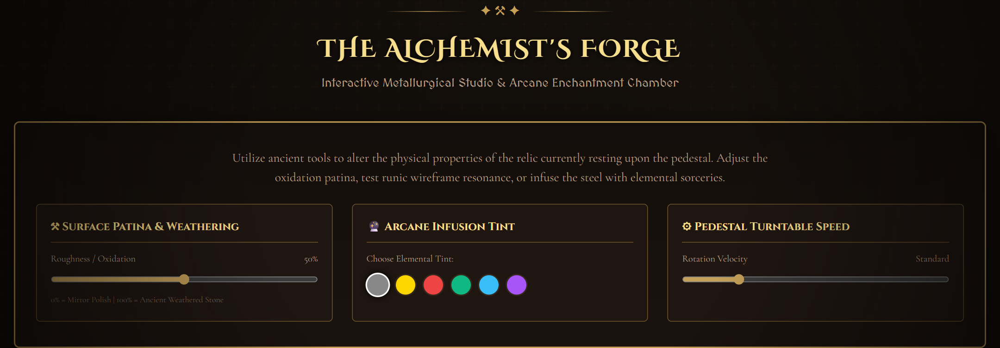

<div align="center">

# 🛡️ THE CHRONICLES OF ELDORIA
### *Vintage 3D Reliquary & Curio Cabinet*

An interactive dark-fantasy 3D showcase exhibiting **26 authentic medieval antiquities, armaments, and architectural relics** with RPG-style character selection, direct 3D model downloads, and procedural audio.

[](https://soorajstudio.github.io/Old-vintage-webiste/)
[](https://threejs.org/)
[-38bdf8?style=for-the-badge)](https://github.com/soorajstudio/Old-vintage-webiste)
[](./LICENSE)

### **[👉 Launch Live 3D Reliquary Demo](https://soorajstudio.github.io/Old-vintage-webiste/)**

---

</div>

## 📸 Preview

<div align="center">
  
</div>

<br>

<div align="center">
  
  
</div>

---

## ✨ Features

- **🎮 Game-Style Selection**: Switch between 26 3D relics using on-screen brass chevrons (`‹ PREV` / `NEXT ›`) or keyboard arrow keys (`←` / `→`).
- **🎴 Square Preview Deck**: Bottom carousel with pre-rendered 3D thumbnail cards, active gold highlights, and auto-centering scroll.
- **📥 Direct 3D Model Downloads**: One-click binary `.glb` downloads from the Codex sidebar, catalog cards, or lore modals.
- **📜 Curator's Codex**: Historical lore, discovered origin, weight, material composition, and dynamic RPG combat/arcana stats.
- **⚒️ Alchemist's Forge**: Interactively tweak surface patina/roughness, wireframe mode, and elemental color infusions in real time.
- **💡 4 Lighting Shaders**: Hearthfire (warm candlelight), Moonlit Crypt, Arcane Resonator, and Sunlit Antiquarium.
- **🎧 Procedural Soundscape**: Zero-download ambient fireplace crackles, drone, and tactile brass clicks synthesized via Web Audio API.

---

## 🏺 The Relic Collection (26 Models)

- ⚔️ **Weapons & Armory**: Dwarven War Hammer, Berserker Labrys, Sunfire Greatsword, Viking Shield, Wyrm-Bone Pike, Cleaving Hatchet, Mining Mattock.
- 🧪 **Alchemy & Arcana**: Celestial Elixir, Apothecary Flask, Pale Reaper Skull Decanter, Resonator Crystal, Covenant Parchment Scroll.
- 🏰 **Architecture & Landmarks**: Bastion Watchtower, Enchanted Fairy Cottage, Boar's Head Tavern, Timber Workshop, Moss Shrine, Crossroads Signpost.
- 🗝️ **Relics & Curios**: Gilded Corsair Chest, Wrought Iron Lantern, High Kings' Urn, Astrolabe Sphere, Chrono-Data Matrix.

---

## 🚀 Quick Start

### 1. Windows (One-Click)
Double-click [**`start-website.bat`**](./start-website.bat) to launch the server and open the site in your default browser.

### 2. Node.js & Vite Dev Server
```bash
git clone https://github.com/soorajstudio/Old-vintage-webiste.git
cd Old-vintage-webiste
npm install
npm run dev
```
Open **`http://localhost:5174/`**.

### 3. Zero-Build Static / GitHub Pages
Runs natively in any browser with **no build step** via W3C Import Maps:
```bash
python -m http.server 8080
```
Or host directly on **GitHub Pages** (Settings > Pages > Source: `Deploy from a branch` > `main` / `root`).

---

## 🎮 Controls

| Input | Action |
| :--- | :--- |
| **`←` / `→` Arrow Keys** | Navigate to previous / next antiquity |
| **Left Click + Drag** | Orbit and rotate the 3D model 360° |
| **Scroll Wheel / Pinch** | Zoom in / out (auto-bounded) |
| **Right Click + Drag** | Pan camera position |

---

## 📜 License

[MIT License](./LICENSE) • 3D models courtesy of PixelLabs, Aberrant Realities, and Tripo for archival study.
