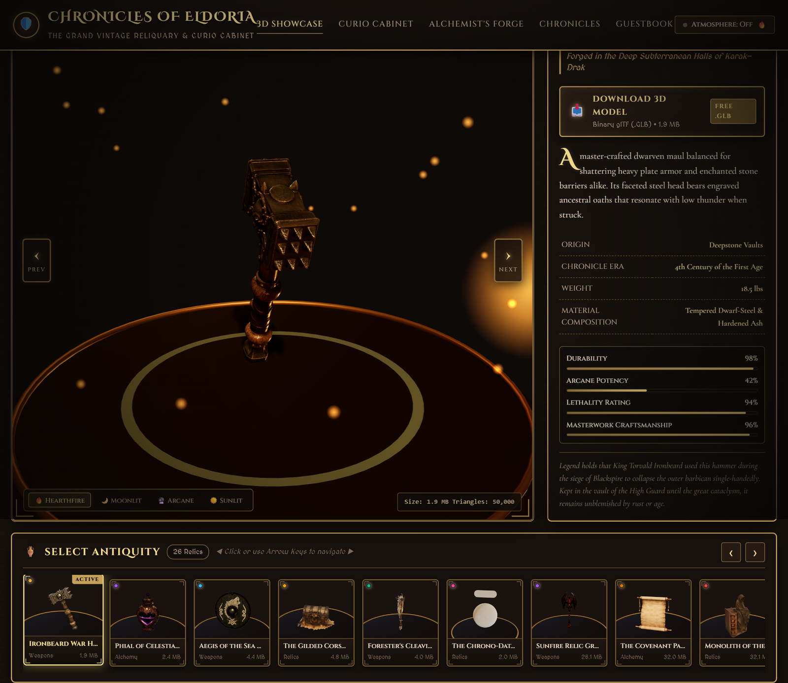
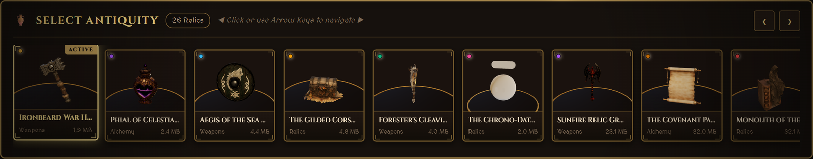
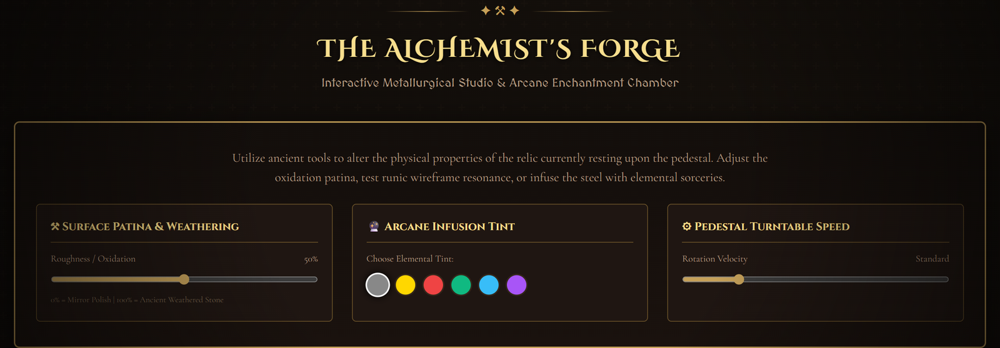
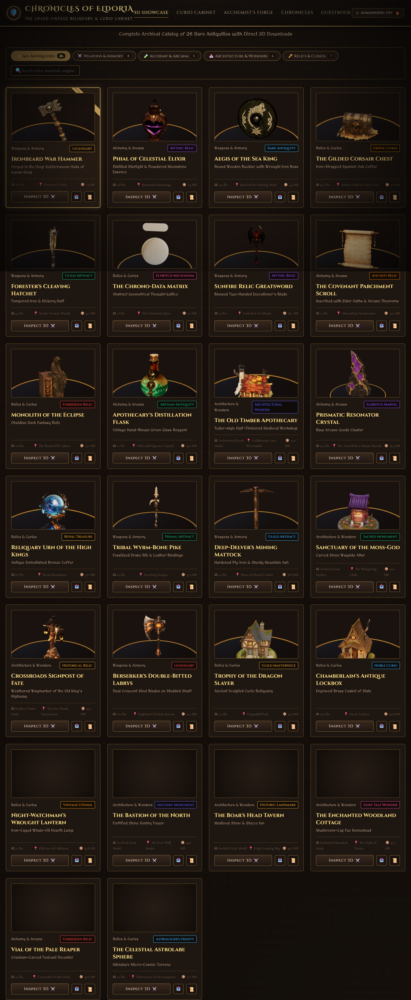

# Old-vintage-webiste

<p align="center">
  
  
  
  
  
</p>

An interactive dark-fantasy 3D showcase exhibiting **26 authentic medieval antiquities, armaments, and architectural relics** with RPG-style selection deck, direct 3D model downloads, customizable lighting shaders, and procedural ambient audio.

---

## 📸 Hero Preview

<p align="center">
  
</p>

## 🖼️ UI Snapshot Gallery

<p align="center">
  
  
</p>
<p align="center">
  
</p>

---

## 🎮 Controls

| Action | Control | Description |
|---|---|---|
| **Orbit / Rotate** | `Left Click + Drag` | Full 360° inspection around the active relic |
| **Pan Camera** | `Right Click + Drag` | Translate viewport position |
| **Zoom** | `Mouse Wheel` | Smooth perspective zoom in / out |
| **Switch Relics** | `←` / `→` or On-screen Chevrons | Cycle through the 26 antiquity artifacts |
| **Alchemist's Forge** | Click `Forge` tab | Tweak surface roughness, wireframe, and tints |

---

## ✨ Features

- 🛡️ **26 Detailed 3D Antiques** - Battle axes, bone spears, viking shields, potions, shrines, lanterns, and medieval dwellings.
- 🎴 **Bottom Relic Deck** - Carousel with 3D thumbnail previews, active highlights, and auto-centering scroll.
- 📥 **Direct Binary Downloads** - Instant 1-click `.glb` 3D model downloads for 3D printing or game development.
- 📜 **Curator's Codex** - Discover origin lore, physical mass, material composition, and dynamic RPG combat stats.
- ⚒️ **Alchemist's Forge** - Live material shaders, procedural wireframe toggles, and elemental color infusions.
- 💡 **4 Dynamic Lighting Presets** - Hearthfire (candlelight), Moonlit Crypt, Arcane Resonator, and Sunlit Antiquarium.
- 🎧 **Procedural Soundscape** - Synthesized crackling hearthfire ambience and tactile brass clicks via Web Audio API.

---

## 🛠️ Tech Stack

- **3D Engine**: Three.js (GLTFLoader, OrbitControls)
- **Tooling & Bundler**: Vite
- **Audio Engine**: Web Audio API (Procedural noise & sound synthesis)
- **Styling**: Custom Medieval Brass & Leather CSS theme

---

## 🚀 Quick Start

### 1. Clone the repository
```bash
git clone https://github.com/soorajstudio/Old-vintage-webiste.git
cd Old-vintage-webiste
```

### 2. Install dependencies & run development server
```bash
npm install
npm run dev
```

Open [http://localhost:5173](http://localhost:5173) in your browser.

> **Windows One-Click**: You can also double-click `start-website.bat` to launch immediately.

---

## 📄 License

This project is licensed under the MIT License — see the [LICENSE](LICENSE) file for details.

Developed with ❤️ by [Sooraj Studio](https://github.com/soorajstudio).
